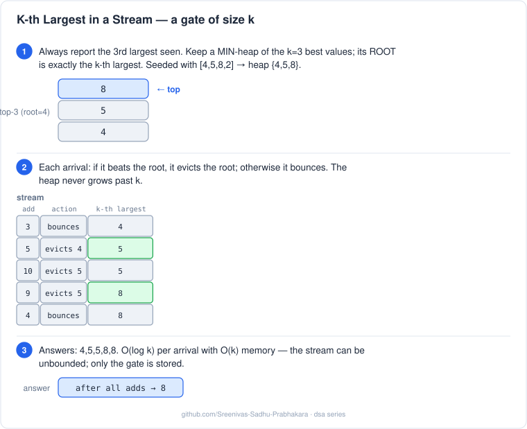

# K-th Largest in a Stream

> Striver SDE Sheet 148 · Day 22 Mixed — the size-k min-heap as a living object: every Add updates it and reads the root. Go, stdlib only, tested.

## Problem

Values arrive indefinitely; after each arrival, report the k-th largest seen so far. The batch version (#070) got the answer once; here the structure must *persist* across adds.

## Approach

Same invariant as #070 — a min-heap holding exactly the k largest values seen, root = k-th largest — but wrapped in a type whose `Add` maintains it incrementally: below capacity, push; otherwise replace the root only if the newcomer beats it (`heap.Fix` re-sinks in one pass, cheaper than pop+push). Each Add is O(log k) regardless of how long the stream runs, and memory never exceeds k — the stream itself is never stored, which is the entire point for unbounded streams. Underfilled streams return ok=false rather than a fake answer.

**Complexity:** Add O(log k), O(k) space.

## Visual walkthrough

Read the picture top to bottom — each numbered frame is one moment of the algorithm
running on this repo's test example.

## Run

    go test ./...   # verify
    go run .        # demo

---

One of 191 repos solving Striver's SDE Sheet in Go — stdlib only, one problem per repo, every solution tested. Browse the set: [`dsa-*` repos](https://github.com/Sreenivas-Sadhu-Prabhakara?tab=repositories&q=dsa-&type=source).
